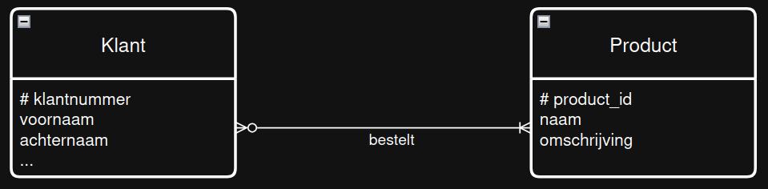
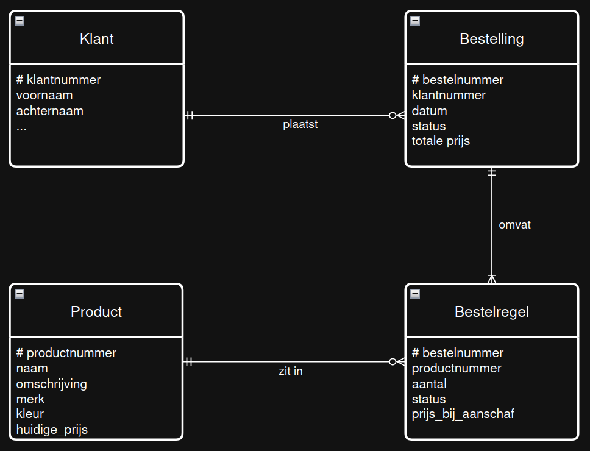

# meer-meer: werkt in een ERD maar _niet_ in een relationele database

Soms ontstaat er in een ERD een zogenaamde meer-meer relatie. Dat betekent dat
in de ERDish zinnen, in beide richtingen de relatie 'meer' bevat.

Bijvoorbeeld de relatie tussen klanten en producten:

- _product_ en _klant_
    - *Ieder* _product_ wordt gekocht door **nul of meer** _klanten_.
    - *Iedere* _klant_ koopt **een of meer** _producten_.

Hier hoort in eerste instantie het volgende ERD bij:

Als we dit zouden willen opslaan in twee tabellen dan lukt dat niet goed: als we in de klant
een product-kolom zouden opnemen, dan kan de klant maar 1 product bestellen. En als we bij product
een klant zouden willen opnemen, dan kan maar 1 klant dat product bestellen.

Met product bedoelen we bijvoorbeeld 'een zwart T-shirt in maar M', waarvan de winkel er bijvoorbeeld
honderd heeft liggen.

Een oplossing zou kunnen zijn dat we voor elk individueel ding een rij aanmaken in de database, maar
dat voelt raar; we gaan dan heel vaak hetzelfde zeggen in de database-tabel alleen maar om dit probleem op te lossen.

Vaak betekent een meer-meer relatie eigenlijk iets op zichzelf en kunnen we een tabel `bestelling` erbij maken. Die kan dan verwijzen naar `klant` en `product`. Nog handiger is het om een vierde entiteit erbij
te maken, die van de 'bestelregel': wat als ik vier zwarte T-shirts wil bestellen?

De "klassieke" structuur voor klanten die producten kopen wordt dan als volgt:

Op deze manier heeft is er geen enkele meer-meer relatie. 

> TIP: Maak voor jezelf de ERDish-zinnen bij elke van deze relaties (dus, zes ERDish zinnen).
Klap daarna de sectie hieronder open om je zinnen te controleren.

  
De ERDish-zinnen voor bovenstaand ERD

- Iedere _klant_ plaatst *nul of meer* _bestellingen_.
- Iedere _bestelling_ is geplaatst door *precies een* klant.

- Iedere _bestelling_ omvat *een of meer* _bestelregels_.
- Iedere _bestelregel_ zit in *precies een* _bestelling_.

- Iedere _bestelregel_ gaat over *precies een* _product_.
- Ieder _product_ zit in *nul of meer* _bestelregels_.

