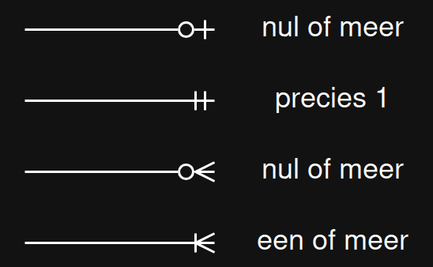
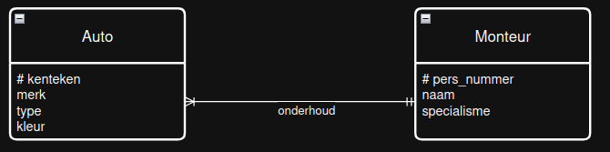

# Database ontwerp, relaties

Een relationele database draait om de relaties die _entiteiten_ met elkaar kunnen hebben:

- _klant_ koopt _product_ 
- _auto_ wordt onderhouden door een _monteur_
- _docent_ doceert een of meer _vakken_

We willen in een ontwerp deze relaties zo precies mogelijk vastleggen.

> Een relatie werkt twee kanten op, dat werkt ook zo bij entiteiten in een database-ontwerp

## Nul, een, meer? 'kardinaliteit'

Voor een database-ontwerp is het van belang te weten 'hoeveel' van de ene entiteit hoort bij de andere entiteit.
Bij de analyse stellen we vragen, zoals: "Klopt het dat een klant meerdere producten in een winkelmandje kan leggen?"
en "Klopt het dat een winkelmandje bij precies 1 klant hoort?".

>Dit lijken eenvoudige vragen; dit klopt voor zo'n beetje elke online winkel! Soms weten we het antwoord niet meteen zoals de vraag: Klopt het dat een patient maximaal 1 infuuspomp tegelijk gebruikt? (Nee, soms zijn er meer medicijnen die onafhankelijk worden toegediend...)

Om deze aantallen vast te leggen zijn er in een database ontwerp precies vier mogelijkheden voor de relaties:

- Nul of 1
- Precies 1
- Nul of meer
- Een of meer

Voorbeelden:

- Van een klant weten we nul of 1 e-mailadres
- Elke regel in een bestelling hoort bij precies 1 bestelling
- Een product wordt gekocht door nul of meer klanten
- Elke bestelling omvat een of meer producten

*Maar* dit is maar de helft van het verhaal! Van al deze zaken willen we ook de andere kant van de relatie weten. Bijvoorbeeld:

- Elke bestelling bestaat uit 1 of meer regels, en
- Klanten kopen een of meer product.

### ERDish-zinnen

We willen ervoor zorgen dat we structureel alle relaties in de database goed beschrijven.
Dit doen we door relaties tussen entiteiten te beschrijven in een precieze structuur. Voorbeelden:

- _auto_ en _monteur_:
    - *Iedere* _auto_ wordt onderhouden door **precies een** _monteur_.
    - *Iedere* _monteur_ onderhoudt **een of meer** _auto_s.

- _product_ en _klant_
    - *Ieder* _product_ wordt gekocht door **nul of meer** _klanten_.
    - *Iedere* _klant_ koopt **een of meer** _producten_.

Aan de voorbeelden kun je zien dat die zinnen altijd dezelfde structuur hebben:

_Iedere_ **entiteit A** __werkwoord__ ..aantal.. **entiteit B**

En dat de zinnen altijd in paren voorkomen. Als er een relatie is tussen twee entiteiten, dan moet je beide kanten van de relatie beschrijven.

### Voorbeelden van ERD-ish zin-paren:

- Een leerling volgt meerdere vakken. Vakken worden gevolgd door meerdere leerlingen.
- Elke medewerker werkt voor precies 1 afdeling. Voor iedere afdeling werken een of meer medewerkers.
- Elke klant plaatst nul of meer bestellingen. Iedere bestelling is voor precies een klant.
- Elke gebruiker heeft een of meer accounts. Elk account hoort bij precies 1 gebruiker.

## Entiteit-relatie-diagrammen, een plaatje zegt meer

De 'kardinaliteit' die we hierboven beschreven met woorden als 'precies 1', '1 of meer' tekenen we we als zogenaamde kraaienpoten (de Engelse term
hiervoor is Crows Feet). Dit is een veelgebruikte manier om in een diagram de hoeveelheid (ariteit of kartinaliteit) van een relatie te beschrijven.

Deze kraaienpoten zien er zo uit:

Een rondje of streep voor de nul of een. Een enkele streep of drie streepjes in de vorm van een 
vogelpootje voor de 'meer'-variant.

## Van ERDish zinnen naar een ERD

We hebben ERDish zinnen gemaakt om de relaties tussen entiteiten te beschrijven. Dit zetten
we om in een diagram op de volgende manier.

- _auto_ en _monteur_:
    - *Iedere* _auto_ wordt onderhouden door **precies een** _monteur_.
    - *Iedere* _monteur_ onderhoudt **meer dan een** _auto_.

In dit plaatje:
- Wordt iedere entiteit getoond als rechthoek met afgeronde hoeken.
- Zijn attributen opgenomen
- Staan kraaienpoten
- Staat de betekenis van de relatie beschreven op de lijn

Als er meer entiteiten zijn, dan worden die allemaal ondergebracht in een grote plaat.
In de volgende sectie zien we daarvan een voorbeeld.
