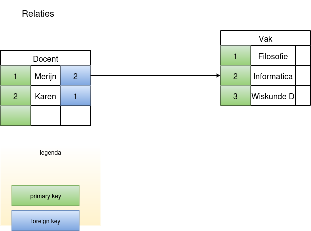

# Sleutels en relaties

Deze module gaat over _relationele_ databases. Dat betekent dat tabellen in een database een relatie kunnen hebben met andere tabellen.

> `¯\_(ツ)_/¯` Het database systeem _postgres_ noemt een _tabel_ een _relation_, dus als je een fout maakt zie je soms 'relation ... does not exist' of zoiets; dan bedoelt postgres een tabel. Naar _mijn_ mening is dat incorrect gebruik van de term relatie; dat is iets tussen twee tabellen. Vind ik.

## Sleutels

Elke rij in een tabel is de vastlegging (een record) van een feit, ding, gebeurtenis etc. Dat zou een 'uniek' iets moeten zijn.
Zouden we leerlingen alleen met voornaam opslaan dan krijgen we al gauw een probleem. Zelfs de combinatie van voor- en achternaam *en* geboortedatum is niet altijd uniek. (De docent heeft een vriend die hier daadwerkelijk last van heeft gehad!). Om die reden is het handig een _technische_ unieke identificatie-kolom te maken. Die noemen we vaak `id`:

```{table} Docent
| id | voornaam | achternaam  |
|----|----------|-------------|
| 1  | Merijn   | Vogel       |
| 2  | Arthur   | Rump        |
| 3  | Pieter   | van Engelen |
| 4  | Karen    | van Wichen  |
```

Zo'n kolom heet `primary key`, de belangrijkste sleutel, van de tabel. Een tabel kan maximaal 1 primary key hebben.

Bij het aanmaken van een tabel met SQL, vertellen we dit ook aan de database:

```sql
CREATE TABLE Docent (id int PRIMARY KEY, voornaam VARCHAR, achternaam VARCHAR);
```

Stel we maken een tweede tabel met parcoursen:

```{table} Parcours
| id  | naam        |
|-----|-------------|
| 100 | Informatica |
| 101 | Filosofie   |
```

Deze heeft ook een primary key.

## Relatie

Nu willen we graag docenten en parcoursen aan elkaar koppelen.
Voor het gemak gaan we ervanuit dat elke docent maar 1 parcours kan geven. We kunnen dan de tabel van docenten uitbreiden:

```{table} Docent
| id | voornaam | achternaam  | parcours_id |
|----|----------|-------------|-------------|
| 1  | Merijn   | Vogel       | 100         |
| 2  | Arthur   | Rump        | 100         |
| 3  | Pieter   | van Engelen | 100         |
| 4  | Karen    | van Wichen  | 101         |
```

We noemen hier niet de naam van het parcours, maar we verwijzen naar de _primary key_ van de tabel _parcours_. Dit legt de _relatie_ vast tussen de twee tabellen.
Door te wijzen naar de _primary key_ van de andere tabel helpen we de database: deze kan efficiënt de gegevens bij elkaar halen.

Dit kunnen we aan SQL vertellen op bijvoorbeeld de volgende manier:

```sql
ALTER TABLE Docent ADD COLUMN parcours_id int REFERENCES Parcours(id);
```

De kolom *parcours_id* heet een _foreign key_: de primaire sleutel van een _andere_ (foreign) tabel.

> De relatie tussen twee tabellen loopt via de _primaire sleutel_ van een van de twee tabellen. Een rij in een tabel verwijst naar de _id_-kolom van de tabel waar die een relatie mee heeft.

In een plaatje:

<!-- todo: plaatje gebruikt de tabel Vak met andere id's dan de tekst (Parcours 100/101) -->


Databases zullen een relatie afdwingen: je kunt alleen nieuwe rijen toevoegen die aan de relatie voldoen; en je kunt rijen niet weghalen als er een verwijzing naartoe is. Die bescherming is een belangrijke eigenschap van relationele databases.
