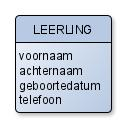
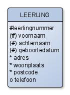

# Meer over entiteiten en attributen

In [](ontwerpen_entiteiten.md) heb je geleerd wat entiteiten en attributen
zijn. In deze verdieping kijken we preciezer naar attributen: welke waarden ze
kunnen hebben, welk type ze krijgen en welke soorten attributen er zijn.

:::{note}
De diagrammen in de verdiepingshoofdstukken zijn in een oudere stijl getekend,
met entiteitnamen in hoofdletters. Ze gebruiken dezelfde kraaienpoot-notatie als
de lesstof.
:::

## Entiteiten, attributen en waarden

Bij het werken met SQL heb je gezien dat gegevens zijn opgeslagen in tabellen,
met rijen en kolommen. Tabellen, rijen en kolommen zijn termen voor de
"fysieke" database. Bij het ontwerpen van databases spreken we van een
*logisch* ontwerp, dat bestaat uit entiteiten en attributen:

- Een *entiteit* is het object waarvan de informatie wordt opgeslagen
- Een *attribuut* is een eigenschap van een entiteit.

De entiteiten en attributen uit een logisch ontwerp worden in een fysiek
ontwerp *tabellen* en *kolommen*.



```{table} Leerling
| voornaam | achternaam | geboortedatum | telefoonnr |
|----------|------------|---------------|------------|
| Piet     | Konijn     | 13-4-2012     | 0611211211 |
| Jan      | Haas       | 15-2-2012     |            |
| Sylvia   | Slak       | 23-7-2011     | 0600700700 |
```

In het voorbeeld hierboven is een leerling een entiteit en geboortedatum een
attribuut. Wanneer je de database gaat bouwen, vul je de rijen van de tabellen
met *waarden* (Engels: values). `Konijn` is dus een waarde. Een leeg vakje
betekent dat er geen waarde is. Je noemt de waarde dan `null`. Deze waarde
`null` is dus iets anders dan de waarde `0`, want dat is wel een waarde. `null`
is letterlijk de verwijzing naar niets. Geen waarde.

Hieronder staat een voorbeeld van een fysiek ontwerp van de tabel `leerlingen`.
Zoals je ziet wordt aan elke kolomnaam een *datatype* toegevoegd.

```{table} Fysiek ontwerp van tabel leerlingen
| kolomnaam     | datatype  | lengte | standaardwaarde |
|---------------|-----------|--------|-----------------|
| voornaam      | `varchar` | 20     |                 |
| achternaam    | `varchar` | 30     |                 |
| geboortedatum | `date`    |        |                 |
| tel_nr        | `char`    | 10     |                 |
```

Het *datatype* is het soort gegeven dat wordt opgeslagen. Bij databases komen
de soorten getal (bijvoorbeeld `integer` of `real`), tekst (`varchar`, `char`),
datum (`date`) en plaatje/geluid (`blob`) voor.

Bij het definiëren van een `varchar` geef je de maximale lengte van dat
tekstveld op. Een tekstveld met lengte 50 geef je weer met `varchar(50)`.
Natuurlijk mag je ook kortere tekst opslaan in zo'n tekstveld. Een `char`-veld
van lengte 10 bevat altijd precies 10 tekens: kortere teksten worden aangevuld
met spaties.

Met de _standaardwaarde_ bedoelen we dat er al standaard een waarde is
ingevuld. Wanneer je bijvoorbeeld een kolom "nationaliteit" hebt en bijna alle
klanten hebben de Nederlandse nationaliteit, dan zou je hier "NL" als
standaardwaarde kunnen invullen. Slechts enkele klanten hoeven dit veld dan aan
te passen in hun formulier.

## Soorten attributen

### Vluchtige attributen

Niet alle eigenschappen zijn even geschikt om te gebruiken in een database. In
bovenstaand voorbeeld zou je bijvoorbeeld de eigenschap 'leeftijd' kunnen
gebruiken in plaats van 'geboortedatum'. Dat is echter niet handig, want je
zult dan na iedere verjaardag de leeftijd bij moeten werken. Zo'n veranderende
eigenschap noemen we een *vluchtig attribuut*.

### Verplicht of optioneel

Sommige attributen moeten altijd worden ingevuld. In het voorbeeld hierboven
is dat bijvoorbeeld 'achternaam'. Dit zijn *verplichte attributen*. Andere zijn
*optioneel* en dus niet verplicht. In het voorbeeld hierboven is dat
bijvoorbeeld het telefoonnummer. Niet iedereen heeft een telefoonnummer of wil
dit in de database ingevoerd hebben.

### Unieke identifier (UID)

In een database wil je per se dat iedere rij uniek is. Geen enkele rij mag
exact hetzelfde zijn. Om te garanderen dat dit het geval is, maakt men gebruik
van *unieke identifiers*, afgekort *UID*. Dit kan een attribuut zijn of een
combinatie van attributen. Zelfs een relatie kan deel uitmaken van een UID.

In het voorbeeld hierboven kun je denken dat 'achternaam' een prima UID is. Op
een school kunnen echter verschillende leerlingen met dezelfde achternaam
zitten. Een betere UID zou de combinatie van voor- en achternaam kunnen zijn.
Wanneer je school groot genoeg is, zullen er vanzelf leerlingen met dezelfde
voor- en achternaam op die school zitten. Je zou de UID kunnen definiëren als
de combinatie van voor-, achternaam **en** geboortedatum. Maar ja, hier kleven
ook weer risico's aan. Om alle risico's uit te sluiten, kun je een extra
attribuut toevoegen. In dit geval 'leerlingnummer'. Door voor iedere leerling
een nieuw nummer te gebruiken, is persoonsverwisseling uitgesloten.

In het fysieke model heet een UID de *primary key* (zie
[](sleutels_en_relaties.md)).

De entiteit `LEERLING` zou er dan als volgt uit kunnen zien:



Je kunt deze eigenschappen van attributen als volgt in je ERD weergeven:

- `#` = *primary UID*. Dit is de UID die uiteindelijk gebruikt gaat worden.
  Dit teken gebruiken we ook in de lesstof.
- `(#)` = *secondary UID*. Deze UID wordt als reserve en mogelijk als
  controlemiddel gebruikt. Hier is dat de combinatie van voornaam, achternaam
  en geboortedatum.
- `*` = een verplicht attribuut
- `o` = een optioneel attribuut

## Opdrachten

:::{exercise}
:label: verd-attr-krakkemik

Hieronder staat een verhaaltje. Met dit verhaaltje wil je een database
ontwerpen. Geef aan welke woorden uit dit verhaaltje je als entiteit zou
gebruiken, welke als eigenschap en welke als waarde. Noem ook de eigenschappen
die niet in de tekst genoemd staan maar waarvan wel waarden zijn genoemd.

_Bij autohandel "Krakkemik" staan er auto's van verschillende merken op het
terrein. Zo staat er een rode Opel Astra uit 1998 voor €1500, een groene Ford
Escort uit 2002 voor €2000 en een Peugeot waarvan de prijs €4000 is._
:::

:::{exercise}
:label: verd-attr-tekenen

Teken de entiteit die bij de vorige opdracht hoort. Bedenk zelf de attributen
die niet in de tekst voorkomen. Geef aan welke attributen tot de UID behoren,
welke verplicht zijn en welke optioneel.
:::

:::{exercise}
:label: verd-attr-datatypes

Geef bij ieder attribuut uit de vorige opdracht aan welk datatype en lengte je
zou gebruiken in het fysieke model. Je kunt op
[deze site](https://www.w3schools.com/sql/sql_datatypes.asp) een lijst vinden
van datatypes die in SQL gebruikt worden.
:::

:::{exercise}
:label: verd-attr-paspoort

Leg uit waarom in iemands paspoort niet diens haarlengte staat opgegeven.
:::
