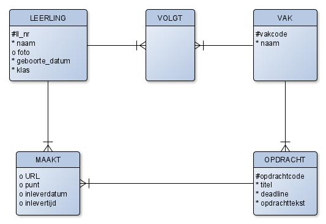
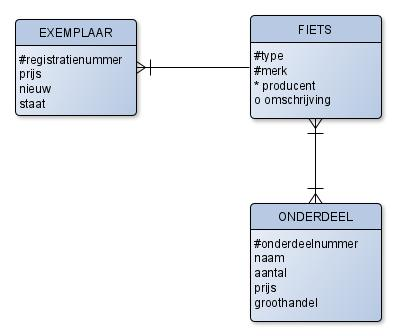

# Van ERD naar SQL

Een goed ERD is het resultaat van de ontwerpfase. Daarna is het tijd voor de
realisatie: het fysieke ontwerp. In deze fase ga je de tabellen en de relaties
tussen deze tabellen daadwerkelijk in SQL-code omzetten.

:::{note}
Het diagram in deze verdieping is in een oudere stijl getekend, met
entiteitnamen in hoofdletters, `*` voor verplichte en `o` voor optionele
attributen (zie [](verdieping_attributen.md)).
:::

Bekijk het onderstaande ERD.



Controleer eerst twee dingen:

- **Zit er geen redundantie (dubbel opgeslagen gegevens) meer in?**
- **Zijn alle meer-meerrelaties opgelost?**

Wanneer je antwoord op beide vragen **ja** is, dan kun je doorgaan met het
fysieke ontwerp.

Om hier SQL-code van te maken, ga je als volgt te werk:

1. Elke entiteit wordt een tabel.
2. Identificeer de primaire sleutels (de UID). Deze geef je dikgedrukt weer.
3. Identificeer de _vreemde sleutels_ (foreign keys: verwijzingen naar andere
   primaire sleutels). Deze geef je weer tussen `<` en `>`.
4. Dit levert je een relationeel model op.
5. Het relationele model zet je om in SQL-DDL.

## Stap 1 tot en met 4

Het bovenstaande ERD geeft je het volgende relationele model:

- leerling(**ll_nr**, naam, geboorte_datum, foto, klas)
- volgt(**&lt;ll_nr&gt;, &lt;vakcode&gt;**)
- vak(**vakcode**, naam)
- opdracht(**opdrachtcode**, titel, opdrachttekst, deadline, &lt;vakcode&gt;)
- maakt(**&lt;opdrachtcode&gt;, &lt;ll_nr&gt;**, URL, inleverdatum, inlevertijd, punt)

Merk op dat:

- de tabel _maakt_ een primaire sleutel heeft die bestaat uit twee vreemde sleutels.
- er nog niet aangegeven staat welke attributen optioneel of verplicht zijn.

## Stap 5

Een relationeel model kun je eenvoudig omzetten naar SQL. Let op dat je nu dus
een keuze maakt voor het soort database: wij kiezen voor een relationele
database met SQL, maar andere opties zijn er ook, zoals NoSQL-oplossingen.

Tot nu toe ben je vooral bekend met _SQL-DML_. Dit staat voor _SQL Data
Manipulation Language_. Met dit deel van SQL kun je gegevens opvragen,
veranderen, invoeren of verwijderen uit een database. Je kent dit als de
`SELECT ... FROM`-statements.

Het deel van SQL waar je nu in gaat werken heet _SQL-DDL_. Dit staat voor
_SQL Data Definition Language_. Kort gezegd kun je met deze SQL-statements
tabelstructuren definiëren en aanpassen. Het relationele model is uitstekend
geschikt om naar SQL-DDL te vertalen. De entiteit `leerling` vertaalt zich naar
het volgende SQL-DDL statement:

```sql
CREATE TABLE leerling (
    ll_nr           CHAR(6)     NOT NULL,
    naam            VARCHAR(20) NOT NULL,
    geboorte_datum  DATE        NOT NULL,
    foto            BLOB,
    klas            VARCHAR(5)  NOT NULL,
    PRIMARY KEY(ll_nr)
);
```

Je vertelt de database letterlijk om een tabel aan te maken met de naam
`leerling`, die bestaat uit de velden `ll_nr`, `naam`, `geboorte_datum`, `foto`
en `klas`. Het veld `ll_nr` is bovendien de primaire sleutel. Elk veld geef je
ook een passend _type_. Voor een volledig overzicht van toegestane types in
SQL, bekijk [dit overzicht](https://www.w3schools.com/sql/sql_datatypes.asp).
Met **`NOT NULL`** geef je aan dat een veld verplicht is en dat `NULL` niet
toegestaan is als waarde. Met andere woorden: het veld mag niet leeg zijn. Uit
je ERD is al duidelijk welke waarden verplicht of optioneel zijn. Deze
informatie kun je dus overnemen in je SQL-DDL.

Een tabel met vreemde sleutels, zoals `maakt`, vertaal je op vergelijkbare
wijze. Er komen alleen twee vreemde sleutels bij in de specificatie.

```sql
CREATE TABLE maakt (
    opdrachtcode    INTEGER     NOT NULL,
    ll_nr           CHAR(6)     NOT NULL,
    url             VARCHAR(50),
    inleverdatum    DATE,
    inlevertijd     TIME,
    punt            NUMERIC(3,1),
    PRIMARY KEY(opdrachtcode, ll_nr),
    FOREIGN KEY(opdrachtcode) REFERENCES opdracht,
    FOREIGN KEY(ll_nr) REFERENCES leerling
);
```

Net zoals je aangeeft welke velden de primaire sleutel vormen, zo geef je aan
welke velden een vreemde sleutel vormen; hiermee maak je aan de database
duidelijk welke relaties er in je tabelstructuur zitten. Bij een
`FOREIGN KEY` geef je niet alleen een veld uit die tabel aan, maar ook een
verwijzing naar een andere tabel. Dit doe je met het keyword `REFERENCES`.

:::{important}
Een vreemde sleutel moet precies hetzelfde type hebben als de primaire sleutel
waarnaar hij verwijst!
:::

Indien een vreemde sleutel dezelfde naam heeft als een al bestaand veld in de
tabel, hernoem dan de vreemde sleutel. Een naam kan in een tabel maar één keer
gebruikt worden.

Laatste belangrijke opmerking: elk SQL-statement sluit je af met een `;`. Dat
geldt eigenlijk ook voor queries in SQL-DML, maar daar wordt meestal niet zo
streng op gelet ;-)

## Opdrachten

:::{exercise}
:label: verd-sql-elo

Maak de `CREATE TABLE` definities voor de tabellen `volgt`, `vak` en
`opdracht` uit het voorbeeld hierboven.
:::

:::{exercise}
:label: verd-sql-fietsen

Bekijk het volgende ERD.



Opmerkingen:

- Type, merk, naam en producent zijn korte stukjes tekst als "Gazelle", "City Explorer", "Terrain beast"
- De staat is: goed, redelijk of slecht
- De prijs heeft twee cijfers achter de komma
- Het veld `nieuw` geeft aan of een fiets nieuw is of tweedehands.

a) Verwijder indien nodig meer-meerrelaties.

b) Maak een relationeel model van dit ERD.

c) Zet dit relationele model om naar SQL-DDL.
:::
