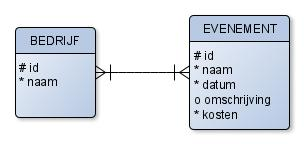
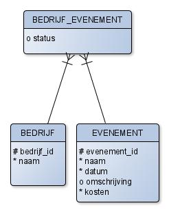
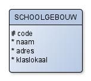
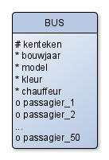
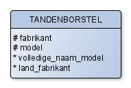
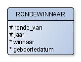
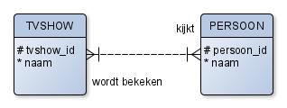

# Een ERD verbeteren

Het komt vaak voor dat een ERD uit meer dan twee entiteiten bestaat. In de
analyse komen er allerlei kandidaat-entiteiten naar voren. Alleen entiteiten
waartussen een relatie bestaat worden in het ERD opgenomen.

:::{note}
De diagrammen in deze verdieping zijn in een oudere stijl getekend, met
entiteitnamen in hoofdletters. Ze gebruiken dezelfde kraaienpoot-notatie als
de lesstof.
:::

## Een matrix van relaties

Om de relaties tussen entiteiten te vinden kun je een matrix gebruiken.
Hieronder staat een voorbeeld.

|                        | REIZIGER       | LAND    | BEZIENSWAARDIGHEID | BETAALMIDDEL      |
|------------------------|----------------|---------|--------------------|-------------------|
| **REIZIGER**           | x              | bezoekt | bezoekt            | betaalt met       |
| **LAND**               | wordt bezocht  | x       | bezit              | x                 |
| **BEZIENSWAARDIGHEID** | wordt bezocht  | ligt in | x                  | wordt betaald met |
| **BETAALMIDDEL**       | wordt gebruikt | x       | wordt gebruikt     | x                 |

Nadat je alle entiteiten, attributen en relaties bepaald hebt, is er een grote
kans dat er nog onvolkomenheden in je ERD zitten. De theorie die hierachter zit
heet 'normalisatie'. Dat is een heel technische term; in dit hoofdstuk
bespreken we wat de concrete problemen zijn en welke oplossingen daarbij horen.

## Probleem 1: redundantie, meer van hetzelfde

Bekijk de volgende tabel:

| leerlingnummer | voornaam | vak         | dag     | tijd | lokaal | docent |
|----------------|----------|-------------|---------|------|--------|--------|
| 174            | Robin    | informatica | maandag | 8:30 | 42     | Pieter |
| 175            | Isa      | informatica | maandag | 8:30 | 42     | Pieter |
| 176            | Jamie    | informatica | maandag | 8:30 | 42     | Pieter |
| 174            | Robin    | filosofie   | maandag | 9:30 | 33     | Merijn |
| 175            | Isa      | filosofie   | maandag | 9:30 | 33     | Merijn |

Wat valt er op? Er staat veel dubbele informatie in. Dat noemen we
'redundantie'. Het is onduidelijk wat de _entiteit_ hier is; het zijn er
feitelijk meerdere door elkaar.

Als je een model maakt en je merkt dat je gegevens vaak terug ziet komen, dan
betekent dat meestal dat je een entiteit moet opbreken.

Als de tabel hierboven een schoolrooster voorstelt, dan zou het model moeten
bestaan uit meerdere entiteiten:

- Leerling, met leerlingnummer, naam en andere nodige gegevens
- Vak, met de naam van de vakken en een relatie met de bijbehorende docenten
- Docent, met naam en andere gegevens per docent
- Rooster, dat alles aan elkaar koppelt.

## Probleem 2: meer-meer relaties

In  heb je gezien dat een relationele database geen
meer-meer relaties kan opslaan. De oplossing is een tussen-entiteit, die in de
database een 'koppeltabel' wordt. Hier is nog een voorbeeld.

*Voorbeeld*

*Oplossing*

Je ziet dat de meer-meer relatie nu is verdwenen. De UID van
BEDRIJF_EVENEMENT is een combinatie van bedrijf_id en evenement_id. De
tussen-entiteit moet je zien als een soort kaartje: op ieder kaartje staat een
combinatie van een evenement en een bedrijf. Soms, zoals hier, kun je ook nog
andere attributen aan de tussen-entiteit toevoegen.

## Opdrachten

:::{exercise}
:label: verd-verb-matrix

Maak een matrix bij de volgende entiteiten: garagebedrijf, auto, persoon.
:::

:::{exercise}
:label: verd-verb-schoolgebouw

Verbeter het volgende ERD:

:::

:::{exercise}
:label: verd-verb-bus

Verbeter het volgende ERD. Het gaat over een busmaatschappij waarbij de
passagiers vooraf via internet een bepaalde langeafstandsbus moeten boeken:

:::

:::{exercise}
:label: verd-verb-tandenborstel

Verbeter het volgende ERD:

:::

:::{exercise}
:label: verd-verb-rondewinnaar

Verbeter het volgende ERD:

:::

:::{exercise}
:label: verd-verb-tvshow

Los de volgende meer-meer relatie op:

:::
