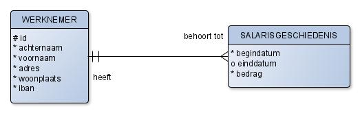
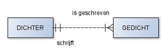
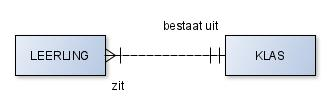
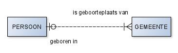
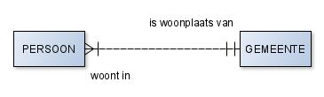
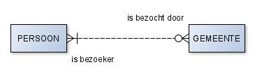
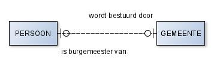

# Meer over relaties en ERD's

In  heb je geleerd hoe je relaties beschrijft met
ERDish-zinnen en hoe je ze tekent met kraaienpoten. In deze verdieping kijken
we naar een paar extra eigenschappen van relaties en oefen je met het lezen en
tekenen van ERD's.

:::{note}
De diagrammen in deze verdieping zijn in een oudere stijl getekend: met
entiteitnamen in hoofdletters en met gestippelde of doorgetrokken lijnen. De
kraaienpoten lees je op dezelfde manier als in de lesstof. Het verschil tussen
gestippeld en doorgetrokken wordt hieronder uitgelegd bij
[ouder-kind relaties](#ouder-kind-relaties); in de lesstof en de eindopdracht
hoef je dat onderscheid niet te maken.
:::

## Checklist voor ERDish-zinnen

- Iedere zin begint met _iedere_ of _elke_.
- De zinnen komen in paren.
- Er zit een werkwoord in de zin.
- "Een of meer", "precies een", "nul of een" en "nul of meer" geven de kardinaliteit aan.
- Het onderwerp en lijdend voorwerp in de zin worden gevormd door entiteiten.
- Vaak moet met de opdrachtgever besproken worden hoe het precies zit. Is het
  bijvoorbeeld toegestaan dat een werknemer meerdere banen heeft?

(ouder-kind-relaties)=
## Ouder-kind relaties

Soms heeft een entiteit geen eigen unieke sleutel, maar hoort ze zo sterk bij
een andere entiteit dat ze alleen via die entiteit te herkennen is. Dat heet
een *ouder-kind*-relatie. De kind-entiteit erft de UID van de ouder-entiteit.
In de oudere diagrammen hieronder zie je dat aan een doorgetrokken lijn; de
andere relaties zijn daar gestippeld.

Er is alleen een primary UID voor `werknemer` gedefinieerd, dus dat is de
ouder-entiteit en `salarisgeschiedenis` is de kind-entiteit. Je zult je nu
afvragen: elke entiteit moet toch een UID hebben? Dat klopt. In het geval van
`salarisgeschiedenis` is de UID `werknemer_id`. De UID voor deze entiteit
bestaat dus niet uit een attribuut, maar uit een relatie!

**Belangrijk**: in het fysieke model komt hiervoor een extra kolom
`werknemer_id` in de tabel `SALARISGESCHIEDENIS`.

## Regels voor een ERD

Een ERD (_Entity Relationship Diagram_) geeft de belangrijke entiteiten en hun
relaties weer. Het doel van een ERD is om in de analyse en het ontwerp een
voorstel te documenteren, waarover met de opdrachtgever gediscussieerd kan
worden.

Informatie mag slechts één keer worden getoond in een ERD. Daarnaast mag je
geen informatie in het model stoppen die kan worden afgeleid van andere
informatie. Bijvoorbeeld: wanneer je de geboortedatum van een persoon al hebt
opgeslagen, mag je niet nog eens de leeftijd van die persoon opslaan. De
leeftijd kan namelijk aan de hand van de geboortedatum berekend worden.

## Constraints

*Constraints* zijn beperkingen of voorwaarden die voortvloeien uit de analyse
van bedrijfsregels. Stel dat een bedrijf wil dat het informatiesysteem een
seintje geeft als een werknemer 25 jaar bij het bedrijf werkt, zodat er iets
georganiseerd kan worden. Dan moet dit in de bouwfase in het informatiesysteem
geprogrammeerd worden. Deze constraints zet je als losse informatie bij je ERD.

Andere voorbeelden:

- Er mogen geen geboortedata worden ingevoerd die in de toekomst liggen.
- Een begindatum moet voor een einddatum liggen.
- Een afdeling moet uit minimaal drie werknemers bestaan.

Dit kun je voor elkaar krijgen door extra programmeerwerk. Afhankelijk van je
database-systeem (DBMS) is dit mogelijk in het DBMS zelf of zul je het in de
applicatie moeten programmeren.

Andere constraints, zoals welke attributen tot de UID behoren, kun je wel in
het ERD opnemen.

## Overdraagbaarheid

Sommige relaties zijn niet *overdraagbaar* (transferable). Dat betekent dat
een rij, als die eenmaal aan een andere rij gekoppeld is, niet meer aan een
andere rij gekoppeld mag worden. In het fysieke model maak je de relatie aan
die kant dan _niet aanpasbaar (not updatable)_. Bekijk het voorbeeld
hieronder.

Een gedicht dat eenmaal door een bepaalde dichter is geschreven, kan later niet
door een andere dichter zijn geschreven. Er moeten maatregelen genomen worden
zodat dit niet aangepast kan worden. De relatie van gedicht naar dichter is dus
niet overdraagbaar.

De relaties hierboven zijn allebei overdraagbaar, want een leerling kan
achteraf naar een andere klas worden overgeplaatst.

## CRUD-analyse

Een ERD leidt uiteindelijk tot een verzameling tabellen waarin we gegevens als
rijen gaan opslaan (de database). Een database vormt de basis voor een
applicatie. Zo'n applicatie is opgebouwd uit verschillende onderdelen, zoals
'Adreswijziging leerling' of 'Cijferoverzicht'. Je kunt per onderdeel een
zogenaamde _CRUD-analyse_ aan je ERD toevoegen. Daarin wordt genoteerd welke
data in dat onderdeel wordt aangemaakt, opgehaald, aangepast en verwijderd.

| Actie        | Betekenis                    |
|--------------|------------------------------|
| **C**reate   | Welke data wordt aangemaakt? |
| **R**etrieve | Welke data wordt opgehaald?  |
| **U**pdate   | Welke data wordt aangepast?  |
| **D**elete   | Welke data wordt gewist?     |

## Opdrachten

:::{exercise} ERDish-zinnen maken
:label: verd-rel-erdish

Maak steeds twee ERDish-zinnen over de relaties tussen de twee entiteiten.

1. Leerling, Klas
2. Leerling, Stoel
3. Fototoestel, Foto
4. Gedicht, Dichter
:::

:::{exercise} ERD lezen
:label: verd-rel-lezen

1. Schrijf de ERDish-zinnen op bij onderstaande relaties in het ERD. Let op de
   richting van de relaties!
2. Er staan een paar relaties tussen die in werkelijkheid niet kloppen. Schrijf
   achter iedere zin of de relatie kan of niet kan.

:::

:::{exercise} ERD tekenen
:label: verd-rel-tekenen

Teken ERD's bij de volgende relaties.

1. Iedere woonplaats is de geboorteplaats van nul of meer personen. Iedere persoon is geboren in precies één woonplaats.
2. Iedere kamer herbergt nul of meer gasten. Iedere gast logeert in precies één kamer.
3. Iedere werknemer werkt op precies één afdeling. Iedere afdeling heeft één of meer werknemers.
4. Iedere e-mail is gericht aan één of meer personen. Ieder persoon is de geadresseerde van nul of meer e-mails.
5. Ieder stuk gereedschap heeft precies één prijs. Iedere prijs hoort bij één of meer stukken gereedschap.
6. Ieder kind heeft precies één moeder. Iedere moeder heeft één of meer kinderen.
7. Iedere leerling heeft les van één of meer docenten. Iedere docent geeft les aan één of meer leerlingen.
8. Iedere vingerafdruk behoort tot precies één persoon. Ieder persoon heeft één of meer vingerafdrukken.
:::

:::{exercise} Overdraagbaarheid
:label: verd-rel-overdraagbaar

Geef aan welke van de relaties uit de vorige opdracht niet overdraagbaar zijn.
Onderbouw je antwoord.
:::
